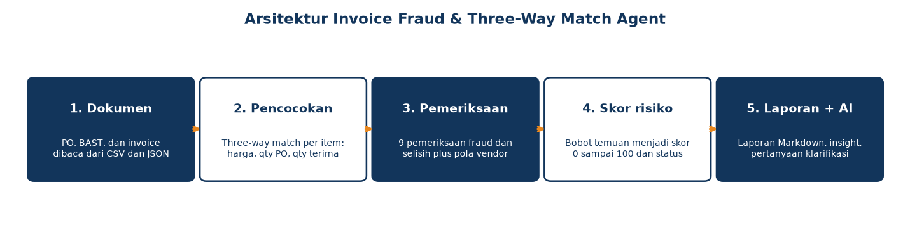
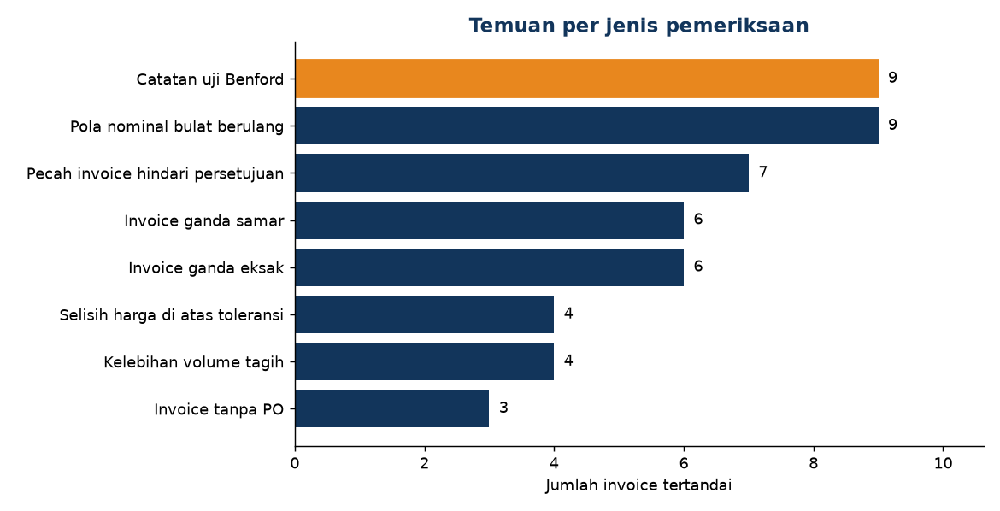
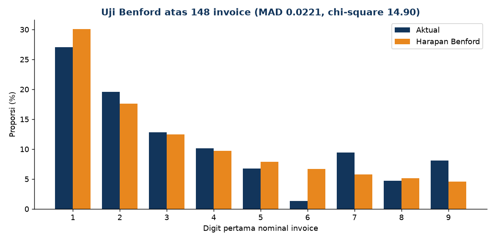
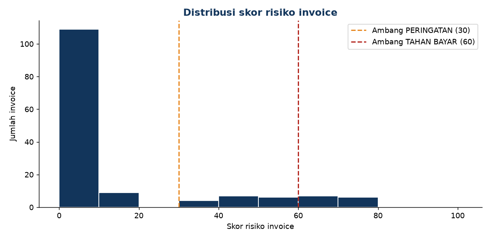

# Invoice Fraud & Three-Way Match Agent

Agent pemeriksa pembayaran vendor untuk perusahaan konstruksi. Agent ini mencocokkan tiga dokumen yang menjadi dasar pembayaran, yaitu purchase order (PO), berita acara penerimaan barang (BAST), dan invoice, lalu menjalankan sembilan pemeriksaan fraud dan selisih dokumen secara deterministik. Setiap invoice menerima skor risiko 0 sampai 100 dan status pembayaran, dilengkapi laporan per invoice, rekap risiko vendor, dan insight AI berupa draf pertanyaan klarifikasi serta opini kedua terstruktur.

Project ini adalah pendamping dua agent portofolio lain: BoQ Cost Checker Agent memeriksa harga pada tahap penawaran, Tender Insight Agent menilai keputusan ikut tender, dan agent ini menjaga tahap pembayaran vendor.



## Cara kerja (5 tahap)

1. **Dokumen dibaca.** Master vendor, PO, BAST, dan invoice dibaca dari berkas CSV dan JSON di folder `samples/`.
2. **Pencocokan three-way.** Setiap invoice ditautkan ke PO dan BAST-nya. Per item dibandingkan harga PO melawan harga invoice, qty PO melawan qty yang diterima pada BAST, dan qty yang ditagih, termasuk kumulatif seluruh tagihan untuk PO tersebut.
3. **Sembilan pemeriksaan dijalankan.** Pemeriksaan selisih dokumen, invoice ganda, pecah invoice, pola nominal, sampai uji statistik Benford, ditambah satu pemeriksaan level vendor untuk rekening bank yang dipakai bersama.
4. **Skor dan status.** Setiap jenis temuan memiliki bobot. Skor invoice adalah jumlah bobot temuannya (maksimum 100). Temuan keras langsung memaksa status TAHAN BAYAR.
5. **Laporan dan insight AI.** Laporan Markdown per invoice tertandai, rekap risiko vendor, ringkasan eksekutif, serta draf pertanyaan klarifikasi ke vendor dan opini kedua dalam format JSON. LLM bersifat opsional dan hanya dipakai bila API key tersedia; tanpa key, insight dihasilkan dari templat deterministik.

## Sembilan pemeriksaan dan bobotnya

| No | Pemeriksaan | Cara mendeteksi | Bobot | Keras |
| ---: | --- | --- | ---: | :---: |
| 1 | Invoice ganda eksak | Vendor dan nomor invoice yang sama (setelah normalisasi digit) muncul lebih dari sekali | 70 | ya |
| 2 | Invoice tanpa PO | Invoice tidak mencantumkan referensi PO, atau referensi PO tidak ditemukan | 65 | ya |
| 3 | Kelebihan volume tagih | Kumulatif qty yang ditagih per item melebihi qty yang diterima pada BAST | 60 | ya |
| 4 | Invoice ganda samar | Nomor berbeda tipis (jarak edit maksimal 1), vendor dan nominal sama, tanggal berjarak maksimal 14 hari | 55 | tidak |
| 5 | Pecah invoice | Tiga invoice atau lebih dari vendor yang sama dalam 7 hari, masing-masing di bawah batas persetujuan Rp50.000.000, totalnya melebihi batas itu | 45 | tidak |
| 6 | Kumulatif melebihi nilai PO | Total tagihan kumulatif untuk satu PO melampaui nilai PO | 40 | tidak |
| 7 | Selisih harga di atas toleransi | Harga satuan invoice lebih tinggi dari harga PO lebih dari 1 persen | 35 | tidak |
| 8 | Pola nominal bulat berulang | Minimal 40 persen invoice satu vendor bernominal bulat penuh (kelipatan Rp1.000.000), dari minimal 5 invoice | 10 | tidak |
| 9 | Catatan uji Benford | Invoice besar (Rp50.000.000 ke atas) dari vendor yang distribusi digit pertama nominalnya menyimpang ekstrem dari Benford (MAD di atas 0,15 untuk sampel vendor kecil) | 5 | tidak |

Satu pemeriksaan tambahan berjalan pada level vendor: **rekening bank yang dipakai bersama** oleh dua vendor berbeda. Temuan ini tidak masuk skor invoice, tetapi menambah 15 poin pada skor risiko kedua vendor dan ditampilkan pada rekap vendor, karena pola ini lazim dipakai untuk menyamarkan vendor fiktif atau konflik kepentingan.

Uji Benford juga dihitung pada level dataset: distribusi digit pertama seluruh nominal dibandingkan dengan distribusi Benford memakai chi-square dan MAD (mean absolute deviation) mengikuti kriteria Nigrini.

## Status invoice

| Status | Aturan |
| --- | --- |
| BERSIH | Skor di bawah 30 dan tidak ada temuan keras |
| PERINGATAN | Skor 30 sampai 59 |
| TAHAN BAYAR | Skor 60 ke atas, atau ada temuan keras (ganda eksak, tanpa PO, kelebihan volume) |

Skor risiko vendor dihitung dari 60 persen rata-rata skor invoice ditambah 40 persen skor invoice maksimum vendor tersebut, ditambah bonus 15 bila vendor berbagi rekening dengan vendor lain, dibatasi 100.

## Dataset contoh

Dataset dibuat oleh `generate_data.py` dengan seed tetap sehingga reproduksibel. Seluruhnya fiktif: 10 vendor bahan dan jasa konstruksi, 24 PO, 24 BAST, dan 148 invoice periode Januari sampai Juni 2026 dengan total nilai tagihan Rp4.828.692.997. Fraud disuntikkan secara terkendali dan dicatat pada `samples/labels.json` sebagai label kebenaran:

| Label | Jumlah invoice | Keterangan |
| --- | ---: | --- |
| clean | 109 | Transaksi bersih, termasuk kasus batas yang sah: harga sedikit di bawah PO (dalam toleransi), satu dua invoice bernominal bulat dari vendor biasa, invoice besar di atas Rp50 juta dengan PO yang jelas |
| ganda_eksak | 6 | Tiga pasang invoice dengan vendor dan nomor yang sama |
| ganda_samar | 6 | Tiga pasang invoice bernomor beda tipis dan nominal sama |
| pecah_invoice | 7 | Dua kelompok (4 dan 3 invoice) di bawah batas persetujuan |
| tanpa_po | 3 | Invoice tanpa referensi PO |
| kelebihan_volume | 4 | Tagihan atas qty yang tidak pernah diterima (BAST parsial) |
| selisih_harga | 4 | Harga satuan 6 sampai 12 persen di atas harga PO |
| angka_bulat | 9 | Seluruh invoice PT Granit Alam Sejahtera bernominal bulat penuh berkepala digit 9 |

Di luar label invoice, master vendor memuat satu pasang vendor yang berbagi nomor rekening yang sama.

## Hasil evaluasi

Evaluasi membandingkan temuan agent terhadap `labels.json`. Invoice dinilai terdeteksi untuk satu jenis fraud bila agent menghasilkan temuan berjenis sama dengan labelnya. Hasil berikut adalah output nyata `run_eval.py` atas dataset contoh, tanpa pembulatan ke atas:

| Jenis fraud | Label | Deteksi | TP | FP | FN | Precision | Recall | F1 |
| --- | ---: | ---: | ---: | ---: | ---: | ---: | ---: | ---: |
| ganda_eksak | 6 | 6 | 6 | 0 | 0 | 1.000 | 1.000 | 1.000 |
| ganda_samar | 6 | 6 | 6 | 0 | 0 | 1.000 | 1.000 | 1.000 |
| pecah_invoice | 7 | 7 | 7 | 0 | 0 | 1.000 | 1.000 | 1.000 |
| tanpa_po | 3 | 3 | 3 | 0 | 0 | 1.000 | 1.000 | 1.000 |
| kelebihan_volume | 4 | 4 | 4 | 0 | 0 | 1.000 | 1.000 | 1.000 |
| selisih_harga | 4 | 4 | 4 | 0 | 0 | 1.000 | 1.000 | 1.000 |
| angka_bulat | 9 | 9 | 9 | 0 | 0 | 1.000 | 1.000 | 1.000 |
| melebihi_nilai_po | 0 | 0 | 0 | 0 | 0 | - | - | - |
| **Keseluruhan** | **39** | **39** | **39** | **0** | **0** | **1.000** | **1.000** | **1.000** |

Catatan jujur atas hasil ini: pemeriksaan dirancang bersamaan dengan pola fraud yang disuntikkan, dan generator menjaga invariant jadwal serta nominal agar kasus bersih tidak tertukar dengan pola fraud, sehingga nilai sempurna pada dataset sintetis ini dapat dicapai. Pemeriksaan kumulatif melebihi nilai PO tidak memiliki kasus berlabel pada dataset ini (generator menjaga total tagihan tidak melampaui nilai PO); pemeriksaan itu tetap diuji pada level unit test dengan data fixture. Pada data nyata, pola fraud yang lebih beragam akan menurunkan angka ini, dan di situlah evaluasi seperti ini menjadi penting.

Hasil lain dari run yang sama:

- Distribusi status: **BERSIH 118 invoice, PERINGATAN 17 invoice, TAHAN BAYAR 13 invoice**. Nilai invoice yang ditahan Rp327.951.000 dan yang berstatus peringatan Rp301.999.488.
- Rekening dipakai bersama terdeteksi: 1 kelompok, yaitu PT Elektrikal Nusantara Jaya dan PT Kaca Bangun Persada.
- Uji Benford dataset: n = 148, chi-square 14,90, MAD 0,0221, tergolong tidak sesuai menurut pita MAD Nigrini (ambang 0,010), walaupun chi-square masih di bawah nilai kritis 15,51 pada taraf 5 persen. Penyimpangan terutama datang dari vendor pola bulat; MAD per vendor PT Granit Alam Sejahtera adalah 0,2121, tertinggi di antara semua vendor dan jauh di atas vendor lain (0,0570 sampai 0,1153).

## Rekap contoh: vendor risiko tertinggi

| Peringkat | Vendor | Skor risiko | Invoice | Temuan | Tahan bayar | Rekening bersama |
| ---: | --- | ---: | ---: | ---: | ---: | :---: |
| 1 | PT Elektrikal Nusantara Jaya | 44 | 13 | 1 (1 keras) | 1 | ya |
| 2 | PT Kaca Bangun Persada | 43 | 14 | 3 | 0 | ya |
| 3 | CV Plumbing Sejahtera | 38 | 13 | 5 (2 keras) | 2 | tidak |
| 4 | CV Alat Berat Rentindo | 38 | 12 | 4 (2 keras) | 2 | tidak |
| 5 | PT Cat Warna Prima | 36 | 13 | 3 (2 keras) | 2 | tidak |

Rekap lengkap 10 vendor ada di `laporan-contoh/rekap-vendor.md` dan ringkasan analisis di `laporan-contoh/ringkasan.md`, beserta contoh laporan per invoice untuk seluruh invoice TAHAN BAYAR.

## Visual







## Struktur repo

```
invoice-fraud-agent/
  generate_data.py        Generator dataset sintetis berlabel (seed tetap)
  loader.py               Pembaca vendors.json, pos.csv, receipts.csv, invoices.csv
  matching.py             Mesin pencocokan three-way PO vs BAST vs invoice
  checks.py               9 pemeriksaan fraud dan selisih + pemeriksaan rekening bersama
  scoring.py              Bobot temuan, skor dan status invoice, risiko vendor
  ai_insight.py           Insight AI: pertanyaan klarifikasi, opini kedua JSON, ringkasan
  report.py               Pembuat laporan Markdown
  cli.py                  CLI analisis dan penulisan laporan
  run_eval.py             Evaluasi precision, recall, F1 terhadap labels.json
  store.py                Simpan hasil analisis ke SQLite
  build_dashboard_data.py Bangun dashboard/data.js dari hasil analisis nyata
  build_notebook.py       Bangun notebook evaluasi dengan output nyata tertanam
  make_visuals.py         Bangun grafik di docs/img dari angka nyata
  samples/                Dataset contoh: vendors.json, pos.csv, receipts.csv, invoices.csv, labels.json
  db/                     schema.sql dan queries.sql untuk SQLite
  dashboard/              Dashboard statis (index.html, style.css, app.js, data.js)
  notebooks/              evaluasi.ipynb dengan output nyata
  docs/img/               Visual README dari angka nyata
  laporan-contoh/         Contoh laporan nyata hasil run (ringkasan, rekap, invoice TAHAN BAYAR)
  scripts/run_demo.sh     Demo ujung ke ujung satu perintah
  tests/                  33 tes pytest
  Dockerfile
```

## Cara pakai

```bash
pip install -r requirements.txt

# 1. Hasilkan dataset contoh (opsional, dataset sudah disertakan)
python generate_data.py

# 2. Jalankan analisis dan tulis laporan ke folder hasil/
python cli.py --samples samples --out hasil

# 3. Evaluasi terhadap label kebenaran
python run_eval.py --samples samples

# 4. Simpan hasil ke SQLite dan buka dashboard
python store.py --samples samples --db invoice_fraud.db
python build_dashboard_data.py
# buka dashboard/index.html di browser

# Atau jalankan demo ujung ke ujung
bash scripts/run_demo.sh

# Tes
python -m pytest tests/ -q
```

## Lapisan AI

Modul `ai_insight.py` menyusun untuk setiap invoice tertandai: draf pertanyaan klarifikasi yang siap dikirim ke vendor, opini kedua terstruktur (pola fraud terduga, bukti terkuat, langkah verifikasi), dan ringkasan eksekutif untuk rekap. Bila env `INVOICE_FRAUD_LLM_API_KEY` terisi, opini kedua diminta dari endpoint yang kompatibel dengan OpenAI (`INVOICE_FRAUD_LLM_BASE_URL`, `INVOICE_FRAUD_LLM_MODEL`). Tanpa key, seluruh insight dibuat dari templat deterministik berdasarkan temuan, sehingga tidak ada dependensi layanan eksternal untuk menjalankan demo.

## Catatan data

Seluruh vendor, PO, BAST, invoice, nomor rekening, dan nominal pada project ini adalah data fiktif yang dibuat untuk demonstrasi dan pengujian. Nama perusahaan adalah karangan dan tidak merujuk pada perusahaan nyata. Ambang dan bobot pada pemeriksaan adalah pilihan desain yang didokumentasikan di `checks.py` dan `scoring.py`, bukan standar industri.
